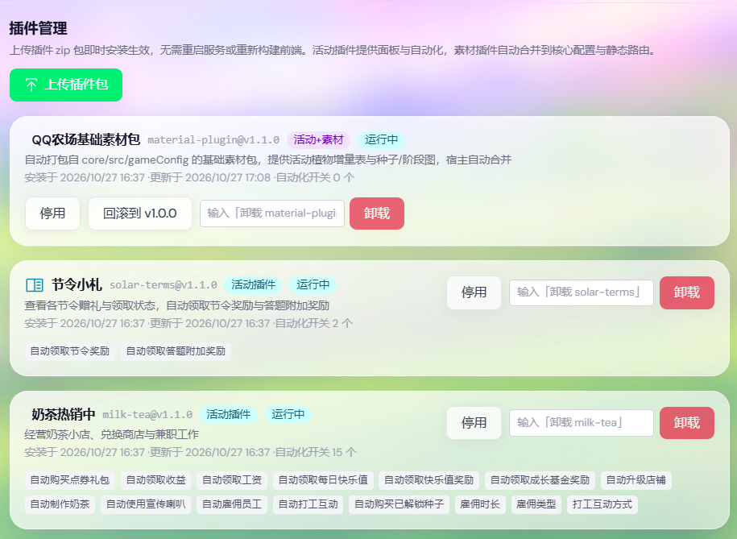

<div align="center">


# QQ Farm Bot

🌱 一位会自己浇水、除草、收菜的 QQ 农场小帮手

[能做什么](#-能做什么) · [活动插件](#-活动插件) · [自动化](#-自动化怎么开) · [微信扫码](#-微信扫码登录) · [开始种田](#-开始种田) · [Docker 部署](#-docker-部署) · [更新记录](docs/CHANGELOG.md) · [使用文档](#-使用文档) · [支持项目](#-支持项目)

</div>

> [!WARNING]
> 快乐种田，谨慎使用。本项目仅供学习和研究，自动化操作可能违反游戏服务条款，账号及其他相关风险由使用者自行承担。

> [!TIP]
> 欢迎 Fork 本项目并提交 PR。项目主要由个人利用业余时间维护，精力有限，功能更新、问题修复和兼容性适配难免有所遗漏。如果你发现 Bug、有新的想法，或有更好的实现方案，欢迎直接参与贡献，共同完善项目。

## 🌾 能做什么

- 👨‍🌾 **照看多座农场**：多个账号统一管理，也可以单独控制
- 💧 **打理日常农活**：农场、好友、任务、商城和活动自动化
- 🖥️ **随时看看田里**：Web 控制面板、实时日志和数据统计
- 🌻 **认识每株作物**：作物图鉴、土地状态和变异效果展示
- 🧩 **活动即插即用**：限时活动做成插件，管理面板上传 zip 即装即用、卸载即停，无需重启或重新构建
- 📱 **轻松添加账号**：支持内置微信扫码、手机抓包登录和 QQ 好友同步
- 📦 **多种方式开工**：支持源码、Docker 和桌面二进制构建

> 🌱 想看看这片农场是怎么一步步长大的吗？前往[农场成长记录](docs/CHANGELOG.md)查看最新更新和完整历史。

## 🧋 最新更新 · v2.9.0

- **活动插件系统上线**：限时活动不再写死在主程序里，改为标准插件包（manifest 契约 + 后端服务 + 前端面板 + 素材）。管理员在「后台 → 活动插件」上传 zip 即安装生效，支持停用/启用/升级/一键回滚，全程无需重启服务。
- 「奶茶热销中」与「节令小札」完成插件化迁移：活动卡片、手工操作面板、全部自动化开关（含奶茶点券礼包自动购买、节令答题）均由插件提供，官方活动时间窗结束或插件卸载后开关自动关闭。
- 内置活动的时间窗不再需要前后端双写；插件活动的窗口、开关类型与文案统一由插件 manifest 声明，配置归一化按声明自动执行。
- 插件开发流程与宿主契约见[活动插件开发指南](core/docs/plugin-development.md)，从抓包恢复协议到打包上传可以直接照做。

## 🧩 活动插件

活动中心与自动化里的限时活动以**插件**形式交付。对使用者来说：

- **安装**：把活动插件包（zip）在「后台 → 活动插件」上传，活动卡片、操作面板和自动化开关立刻出现，无需重启。
- **升级**：同名插件重复上传即升级，旧版本自动保留，可一键回滚。
- **停用 / 卸载**：停用保留安装可随时再启用；卸载会删除插件并自动关闭它在所有账号上的自动化开关。
- **过期保护**：插件声明的活动时间窗结束后，相关开关自动关闭并阻止后台执行；常驻活动（如节令小札）不受时间窗限制。

<div align="center">



</div>

仓库内置三个插件（`core/plugins/`）：

| 插件 | 形态 | 说明 |
| --- | --- | --- |
| 基础素材包（material-plugin） | 素材插件 | 合并活动植物增量、种子图、阶段图、GUI 道具图标等；宿主自动加载，禁止停用 |
| 奶茶热销中（milk-tea） | 限时活动 | 店铺经营、兑换商店、雇佣打工、350 个协议素材、完整的自动化与手工操作面板 |
| 节令小札（solar-terms） | 常驻活动 | 节令赠礼领取与答题，无素材轻量插件，含官方题库 |

想为官方新活动制作插件？从抓包恢复协议到打包上传的完整流程见[活动插件开发指南](core/docs/plugin-development.md)。

## 🤖 自动化怎么开

后台自动化统一在 **设置 → 账号设置 → 日常与活动** 里开关，按账号单独配置；活动结束后对应开关会自动压关。

### 日常与农场

| 开关 | 说明 |
| --- | --- |
| 农场 / 好友 / 偷菜 / 帮助 | 巡田、收获、出售、好友帮助与偷取 |
| 任务 / 神秘商人 | 日常任务领取、神秘商人自动购买 |
| 施肥与土地 | 智能施肥、土地升级、化肥补货 |

### 活动类（随活动插件提供）

活动自动化开关在对应活动的插件卡片里，按活动窗口自动显隐：

- **奶茶热销中**：领取收益与工资、制作奶茶、升级店铺、雇佣员工、使用宣传喇叭、打工互动、购买已解锁种子、领取快乐值与成长基金奖励、自动购买点券礼包；自动雇佣可选择时长与员工类型。
- **节令小札**：自动领取节令奖励、按官方答题时间自动作答领取附加奖励。
- **内置活动**（雨落成诗、公益小红花、萌宠成长日记、秋祈良愿、鹊桥寄情等）开关仍在「日常与活动」中；后续活动将优先做成插件，内置活动会逐步迁移出去。

## <th></th> 微信扫码登录

微信玩家可直接在“添加账号 → 微信扫码”中完成登录。扫码链路已内置到 Bot 进程，通过应用宝 OAuth 获取微信会话，并使用内置 MMTLS 协议换取农场短时效 Code，无需额外部署 YYB-GO、第三方登录 API 或代理容器。

## 🧺 小推车里装了什么

| 模块 | 技术 |
| --- | --- |
| 后端 | Node.js、Express、Socket.IO、CommonJS、活动插件宿主 |
| 前端 | Vue 3、Vite、TypeScript、Pinia、UnoCSS |
| 工程 | pnpm workspace、Docker |

管理面板默认住在 `3007` 端口。

## 🚜 开始种田

### 准备工具

- Node.js 20+
- pnpm 10+
- Git

### 把农场跑起来

```bash
git clone https://github.com/Asunxu/qq-farm-bot-404.git
cd qq-farm-bot-404

corepack enable
pnpm install
pnpm build:web
pnpm dev:core
```

看到服务启动后，打开 <http://localhost:3007>，你的农场控制室就准备好了。

想继续装修控制室？可以另外启动前端开发服务器：

```bash
pnpm dev:web
```

## 🐳 Docker 部署

```bash
git clone https://github.com/Asunxu/qq-farm-bot-404.git
cd qq-farm-bot-404
docker compose up -d --build
```

查看运行状态和日志：

```bash
docker compose ps
docker compose logs -f
```

更新代码后重新构建：

```bash
git pull
docker compose up -d --build
```

默认映射：

| 用途 | 端口或目录 |
| --- | --- |
| Web 管理面板 | `3007` |
| 抓包代理端口 | `18000` |
| 持久化数据 | 仓库上级目录的 `data/` |

源码运行、Docker 和二进制发布版的抓包服务均默认开启，随应用启动嵌入服务，
并且只使用代理端口 `18000`。可在“系统配置 → Code/GID 抓取服务”中关闭；旧版配置首次升级时会自动开启，之后手动保存的关闭设置会保留。

如需指定抓包服务对外地址，可在仓库根目录创建 `.env`：

```dotenv
CAPTURE_ADVERTISE_IPS=192.168.1.100,100.64.0.2
```

## 🔑 登录方式

项目支持微信扫码、QQ/NapCat 扫码、手动填码和手机抓包等账号添加方式。

### QQ/NapCat 扫码（Docker，可选）

NapCat 默认不启动，低配置机器继续使用原来的启动命令即可：

```bash
docker compose up -d --build
```

需要 QQ 扫码登录时，复制示例配置：

```bash
cp .env.compose.example .env
```

在 `.env` 中设置：

```dotenv
COMPOSE_PROFILES=napcat
NAPCAT_LOGIN_ENABLED=true
```

随后执行 `./compose.sh up -d --build`。脚本会读取当前 macOS 或 Linux 宿主机名并将其设置为
QQ 登录记录中的设备名称，然后由 Compose 启动农场和 NapCat 两个服务。构建 NapCat
派生镜像时自动安装 OpenAuth 插件，容器首次启动会生成内部随机 Token，并通过只读文件提供给农场
后端，不需要在环境变量中保存密钥。更新农场或插件代码后仍使用同一条命令，不需要手动运行安装
脚本。NapCat 的配置、内部 Token 和 QQ 登录数据保存在 `../data/napcat/`。
如需覆盖自动检测结果，可在 `.env` 中设置 `NAPCAT_DEVICE_NAME`；建议只使用英文字母、数字和
连字符，并在首次登录后保持不变。修改已有部署的名称后，需要重新创建 NapCat 容器才会生效。

默认基础镜像为 `mlikiowa/napcat-docker:v4.18.19`。官方镜像支持 `linux/amd64` 和
`linux/arm64`，覆盖常见的 x64 Linux、ARM Linux、Intel Mac 和 Apple Silicon Mac；macOS
通过 Docker Desktop 运行相应 Linux 架构镜像。官方没有 32 位 `linux/386` 镜像。可在 `.env`
中通过 `NAPCAT_IMAGE` 选择示例文件列出的其他多架构版本。

### 微信扫码

1. 进入“添加账号 → 微信扫码”。
2. 页面会自动生成二维码；也可以点击二维码空态或“获取/刷新二维码”。
3. 使用手机微信扫码，并在应用宝授权页确认。
4. 授权成功后账号会自动添加、开启 Code 刷新并启动。

微信扫码会话与当前面板用户绑定。若凭证已被微信撤销、长时间停机后过期或手机重新授权导致旧会话失效，需要重新扫码。

账号建立 WebSocket 连接后，Bot 会读取登录回包和心跳回包中的 `version_force` 或 `version_recommend`。检测到符合格式的完整版本（例如 `1.13.1.6_20260723`）时，会自动更新“系统配置 → 客户端版本”，后续连接直接使用该值。强制版本优先于推荐版本，日期部分来自服务端原始版本，不会按本机当天日期生成。

### 手机抓包

iPhone及安卓用户也可使用内置抓包登录服务自动获取登录 Code，并同步 QQ 平台好友。

抓包基本流程：

1. 确认“系统配置 → Code/GID 抓取服务”中的抓包登录已开启（默认开启）。
2. 进入“添加账号 → 抓包登录”，点击“开始抓取”。
3. 按页面提示安装并信任 CA 证书，设置手机 Wi-Fi 代理。
4. 完全关闭并重新打开 QQ 农场，等待面板获取 Code。
5. 完成后关闭手机 Wi-Fi 代理。

证书安装、局域网和 Tailscale 配置请查看[抓包登录服务手册](core/docs/capture-service.md)。

## 🛠️ 常用命令

| 命令 | 用途 |
| --- | --- |
| `pnpm dev:core` | 启动后端和已构建的管理面板 |
| `pnpm dev:web` | 启动前端开发服务器 |
| `pnpm build:web` | 构建前端 |
| `pnpm lint` | 检查前后端代码 |
| `pnpm -C core test` | 运行后端测试 |
| `pnpm package:release` | 构建各平台二进制文件 |

二进制构建产物位于 `core/dist/`。首次运行时，程序会在数据目录中生成账号、日志和缓存等文件。

## 🗺️ 农场地图

```text
qq-farm-bot-404/
├── core/                 # 后端、自动化引擎及协议实现
│   ├── docs/             # 登录、活动、插件与 TSDK 维护文档
│   ├── plugins/          # 内置插件（基础素材包、奶茶热销中、节令小札等）
│   ├── src/              # 配置、接口、模型、业务服务与插件宿主
│   └── test/             # 后端测试
├── web/                  # Vue 管理面板
├── docs/                 # 更新记录
├── docker-compose.yml
└── package.json
```

## 📖 使用文档

- [iPhone 抓包登录服务](core/docs/capture-service.md)
- [活动插件开发指南](core/docs/plugin-development.md)
- [限时活动适配手册](core/docs/activity-update-runbook.md)
- [TSDK/WASM 更新手册](core/docs/tsdk-update-runbook.md)
- [TSDK/ACE 运行机制](core/docs/tsdk-ace-runtime.md)

## 🔒 数据与安全

`core/data/` 及 Docker 持久化目录可能包含账号、用户、登录日志、好友缓存和统计数据。请妥善备份，并避免提交到公开仓库。

以下内容不应提交：

- 运行时数据与账号信息
- `.env` 及其他密钥文件
- 日志、缓存和临时文件
- `node_modules/` 与构建产物


## 📌 免责声明
本项目仅供学习与研究用途。使用本工具可能违反游戏服务条款，由此产生的一切后果由使用者自行承担。

**盈利声明**
-  本项目为开源学习项目，任何形式的付费倒卖、源码售卖、付费代部署、收费授权、付费二开等行为均与作者无关。
- 作者自身以及从未授权任何第三方以任何形式向他人收费或牟利。若你通过付费渠道获取本项目，请知悉该费用与作者无关。
- 因倒卖、二次转售造成的损失、账号风险或纠纷，均与作者无关，请自行联系售卖者。

**风险说明**：
- 部署、使用本项目产生的任何封号、数据丢失、法律或其他后果，均由使用者自行承担，作者不作任何担保。
